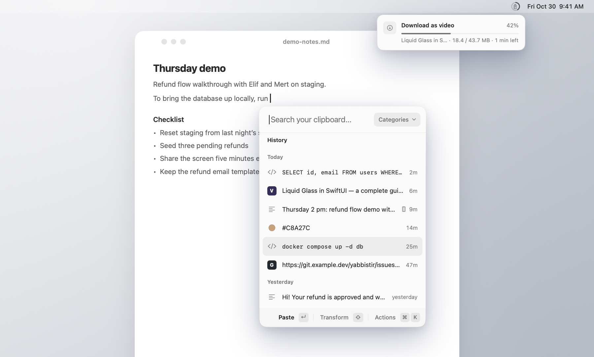
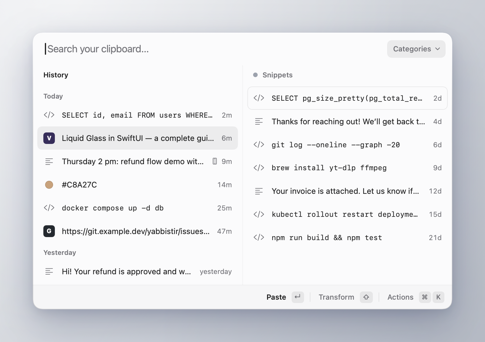
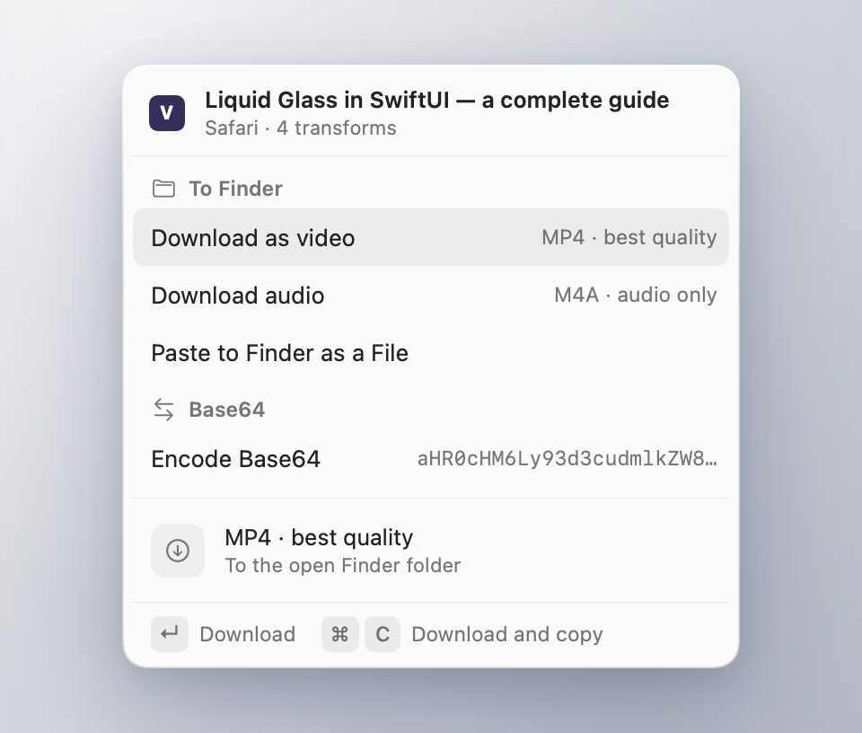
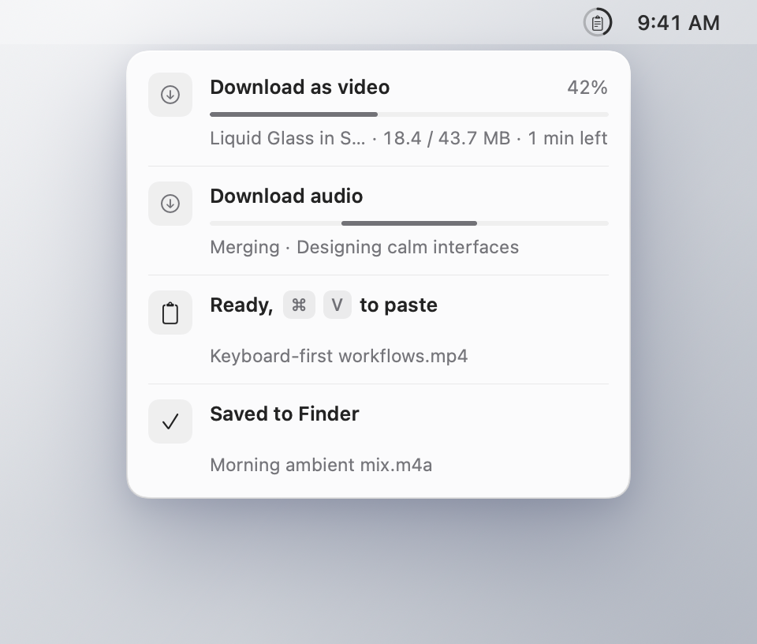

<div align="center">


<h1>yabbistir</h1>

<p><b>A keyboard-first clipboard history for macOS.</b><br>
It opens right under your text caret, finds anything you copied as you type, and pastes it with ↵.</p>

<p>
<a href="https://github.com/berkaygkc/yabbistir/releases/latest"></a>


<a href="LICENSE"></a>
<a href="https://github.com/berkaygkc/yabbistir/releases"></a>
</p>

<a href="https://github.com/berkaygkc/yabbistir/releases/latest"></a>

<p><sub>Free and open source · signed and notarized · nothing leaves your Mac unless you ask: no telemetry, no background network</sub></p>

<br>

<picture>
  <source media="(prefers-color-scheme: dark)" srcset=".github/assets/hero-dark.png">
  
</picture>

</div>

## Why yabbistir

A clipboard history is only useful if reaching it doesn't break your flow. Press ⇧⌘V and yabbistir opens where your eyes already are: just under the text caret, never on top of it. Start typing and it searches. ↵ pastes into the app you were in. You never have to touch the mouse.

It stays out of the way the rest of the time. Rows are one line each, details show up only when you ask for them, and the whole app is a quiet menu bar icon with no Dock icon. The name is a playful way of saying *yapıştır*, Turkish for "paste".

## Features

<table>
<tr>
<td width="50%" valign="top">

#### A panel under your caret
Opens 8 points below the caret (under the pointer in apps that don't report one). Type to search, ↑ ↓ to move, ↵ to paste, ⇧↵ for the item's second choice (plain text for rich text, or a transform you made its default), ⌘1–⌘9 for the first nine. ⌘P adds an item to a category, and a category can open as its own column next to History.

</td>
<td width="50%" valign="top">

#### Stack
Copy several things in a row with ⇧⌘C, then paste them in order: each ⌘V brings up the next one. Drag to reorder. When a new copy lands at the end, ⌥1 moves it to the top or ⌥2 to second place, and the rest of the queue stays as it was.

</td>
</tr>
<tr>
<td valign="top">

#### Transforms
Tap ⇧ on an item to see what can be done with it: encode Base64, turn a color into RGB, HSL, OKLCH or a SwiftUI `Color`, convert an image or read the text in it. ⌘K lists every action. ↵ always pastes the item as it is.

</td>
<td valign="top">

#### Extensions
UUID, Base64, Convert and Paste to Finder as a File are built in. Extensions are small JavaScript packages that add commands, transforms, tags and columns of their own, while yabbistir draws the panel, so they all look and work the same. Each one asks before it reaches the network or runs a program.

</td>
</tr>
<tr>
<td valign="top">

#### Jobs in the menu bar
Long actions, such as downloading a video, run as jobs on a small card under the menu bar icon, and the icon shows their progress as a ring. Up to three run at once; the rest wait their turn.

</td>
<td valign="top">

#### Private by default
Nothing leaves your Mac unless you ask. Password manager copies are never saved. History is kept for a year from the last time you used an item, and items in a category stay until you remove them.

</td>
</tr>
</table>

## Screenshots

<p align="center">
  
</p>

<table>
<tr>
<td width="50%"></td>
<td width="50%"></td>
</tr>
<tr>
<td align="center"><b>Transforms</b>: ⇧ on a link, with Finder in front<br><sub>The download commands come from an example extension that arrives with the extension store</sub></td>
<td align="center"><b>Jobs</b>: long tasks under the menu bar icon<br><sub>The downloads come from an example extension that arrives with the extension store</sub></td>
</tr>
</table>

## Install

**With Homebrew:**

```sh
brew tap berkaygkc/tap
brew trust --cask berkaygkc/tap/yabbistir   # Homebrew 7 and later
brew install --cask berkaygkc/tap/yabbistir
```

**Or download it:**

1. Download `yabbistir-<version>.dmg` from [the latest release](https://github.com/berkaygkc/yabbistir/releases/latest).
2. Open it and drag **yabbistir** to **Applications**.

The app is signed with a Developer ID and notarized by Apple.

**Requirements:** macOS 26 or later on Apple silicon.

## First launch

Open yabbistir from Applications. A short first-run window walks you through the start: pick English or Turkish, bring over another clipboard manager's library if a supported one is found, check the shortcut, allow pasting and choose whether yabbistir opens at login. Settings → About runs it again.

yabbistir lives in the menu bar, with no Dock icon. Click the icon to open the panel (or, while jobs run, to show their card); right-click it for the menu, with Language (English or Turkish), Check for Updates… and Settings…. Settings covers the rest: the shortcuts, where the panel opens and what ↵ does, how long history is kept and which apps it ignores, your categories, permissions, imports and extensions.

yabbistir asks for two permissions, each when it first needs it. Settings → Permissions shows where each one stands and how to allow it:

| Permission | Why |
|---|---|
| **Accessibility** | To paste: yabbistir sends ⌘V to the app you were in, and reads where its text caret is so the panel can open under it. The first-run window asks for it. Until you allow it, ↵ copies the item and you press ⌘V yourself. |
| **Input Monitoring** | For the Stack only: yabbistir listens for your ⌘V so the next item comes up after each paste. macOS asks the first time you use the Stack. Without it, you can still paste from the Stack in the panel; ⌘V just doesn't move it along. |

**Coming from another clipboard manager?** If yabbistir supports it, the first-run window or Settings → Import brings its history and pinboards over. Pinboards become categories, items keep the dates they were copied, nothing comes over twice, and the other app's data is only read; import again later to bring over only what's new. Then quit the other app and take it out of Login Items. The shortcuts, ⇧⌘V and ⇧⌘C, may clash with yours, two apps watching the clipboard at once get in each other's way, and with both running, one ⌘V could move two stacks.

## Extensions

Built in:

- **UUID**: random (v4) or time-ordered (v7).
- **Base64**: encode and decode, and it recognizes Base64 when you copy it.
- **Convert**: colors to RGB, HSL, OKLCH, SwiftUI `Color` or `NSColor`; images to JPEG, PNG or half size; text from an image; an image's background removed.
- **Paste to Finder as a File**: with Finder in front, text, code, links and images land in the open folder as files.

An extension can also fill a column of its own. **LastPass**, in the store, lists your vault's entries by name and username through the `lpass` command-line tool: ↵ pastes the password into the field you're in, ⇧↵ the username.

More extensions are in the open store, [yabbistir-extensions](https://github.com/berkaygkc/yabbistir-extensions): open Settings → Extensions → Store, pick the ones you want and install them together. The store's catalog is signed, and yabbistir checks every package before installing it. Before an extension is installed, it shows what it wants to do: reach websites, run command-line programs, read your history or see what you copy. Nothing happens until you allow it. To write your own, start with the store's README; Settings → Extensions also installs one from a folder or a `.yabext` file.

## Privacy

- **Nothing leaves your Mac unless you ask.** No telemetry, no analytics, no background network. yabbistir itself goes online only when you ask: **Check for Updates…** asks GitHub for the latest version and, if there's a newer one, offers to open its release page; the **Store** tab reads the store's signed list when you open it or press Refresh, and downloads only what you install. The built-in extensions never go online.
- **Passwords stay out.** Copies that apps mark as concealed or transient, the way password managers do, are never saved, and neither is anything copied from Keychain Access or Passwords. A password an extension pastes, such as one from LastPass, goes on the clipboard as a concealed item for this Mac only, and your clipboard comes back a moment later; it's never shown, saved or logged.
- **Local history.** Your history stays on your Mac, in `~/Library/Application Support/yabbistir`. Copies from your iPhone arrive through Universal Clipboard and are kept there too.

## Build from source

You need Xcode 26.2 or later (Swift 6.2) and [XcodeGen](https://github.com/yonaskolb/XcodeGen) (`brew install xcodegen`).

```sh
make build   # generates the Xcode project and builds DerivedData/Build/Products/Debug/yabbistir.app
make test    # runs the package test suite
make run     # builds and opens the app
```

The Xcode project is generated from `project.yml`; don't edit `Yabbistir.xcodeproj` by hand. The built-in extensions are TypeScript: after changing anything under `Extensions/`, run `make extensions` (needs Node).

macOS ties the Accessibility grant to the app's signature. Debug builds are signed ad hoc, so the grant resets on every rebuild. To keep it, create a self-signed **Code Signing** certificate named `yabbistir Dev` in Keychain Access, then copy `Config/Signing.local.xcconfig.example` to `Config/Signing.local.xcconfig`.

A dev build is named "yabbistir Dev" and has its own bundle ID (`dev.yabbistir.app.debug`), so macOS keeps separate Accessibility and Input Monitoring entries for it and for an installed release. It uses the same history. Launching one quits the other, so only one copy is running at a time.

The README images are drawn from synthetic data by `tools/readme-images.sh`.

## Contributing

Bug reports and pull requests are welcome. [CONTRIBUTING.md](CONTRIBUTING.md) explains how to build and test, and what to keep in mind.

## Support

yabbistir is free and open source, and it will stay that way. If it saves you time, you can [sponsor its development](https://github.com/sponsors/berkaygkc) on GitHub Sponsors.

## License

yabbistir is released under the [MIT License](LICENSE). © 2026 Berkay Gökçe.

It uses [GRDB.swift](https://github.com/groue/GRDB.swift) and [KeyboardShortcuts](https://github.com/sindresorhus/KeyboardShortcuts); see [THIRD_PARTY_NOTICES.md](THIRD_PARTY_NOTICES.md).
